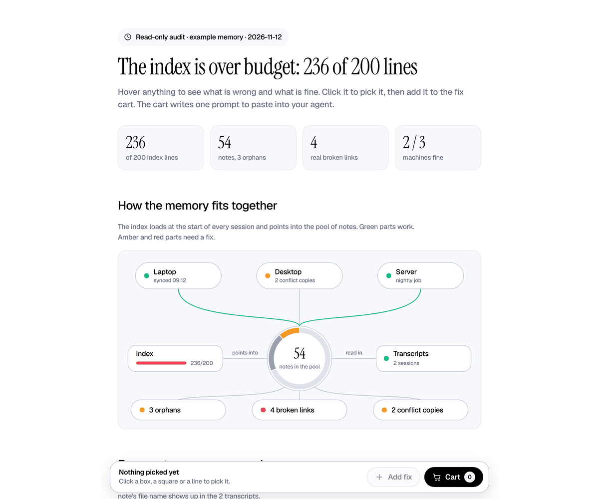
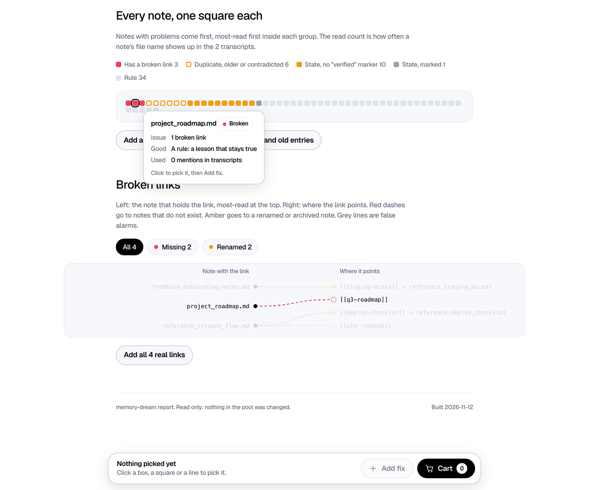
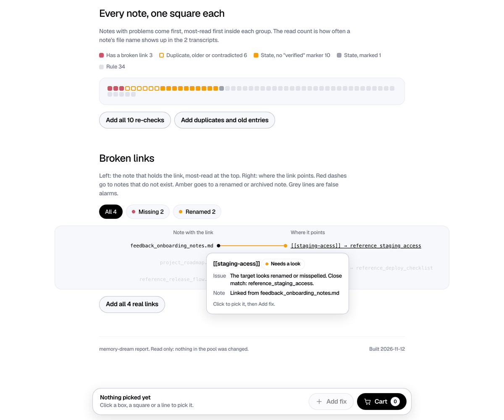
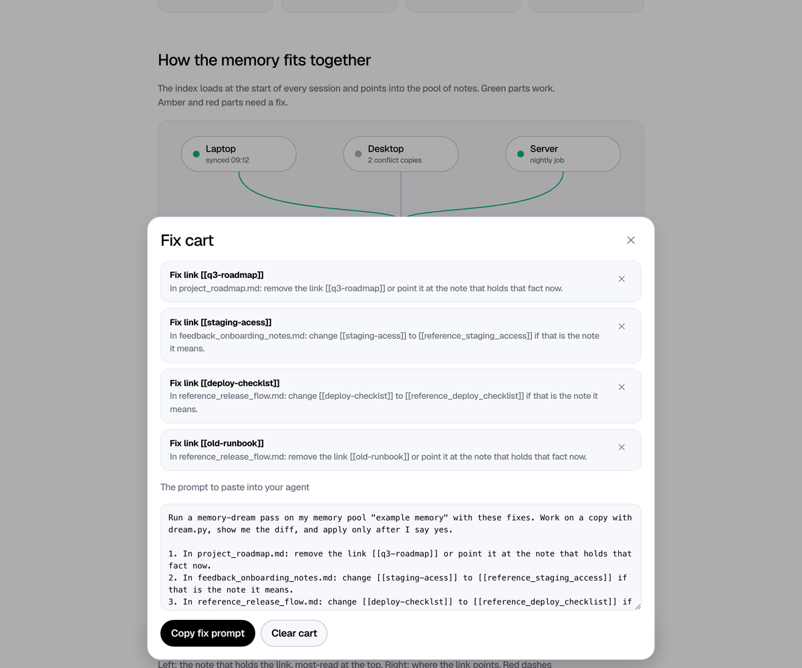
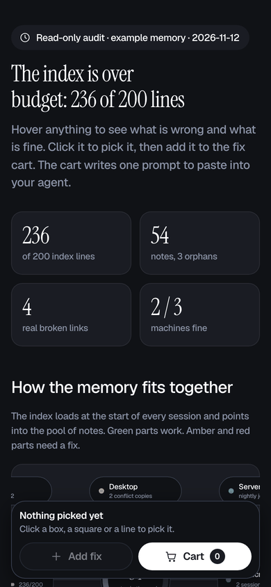

# memory-dream

A skill that checks your AI agent's memory, finds the notes that went wrong, and tidies it up
on a copy so you can see the difference before you keep it.

It works with Claude Code's auto memory, a plain folder of markdown notes, or your own store.
It needs Python 3.8 and nothing else. The scripts never call a model and never touch the network.

## What problem it solves

Agents now keep notes between sessions. Over a few weeks those notes pile up. Some copy things
that change (a port, a version, "this is deployed") and quietly go out of date. Some say the same
thing twice. The index that loads at the start of every session grows past what actually gets
loaded. If two machines share the notes, they overwrite each other and leave "conflict copy"
files behind. The agent keeps trusting all of it.

You usually find out when a session does the wrong thing because an old note said so.

## The research behind it

Anthropic published ["The components of agent memory"](https://www.anthropic.com/research/components-of-agent-memory).
The parts this skill puts to work:

- **A note is a bet that something will matter again.** The best notes record what was worked
  out and how it was checked. Notes that copy live state go stale.
- **Small beats big.** In one test, a model that wrote 413 files earned 1 badge. One that kept
  10 files earned 4.
- **"Dreaming" fixes memory.** An offline pass that checks notes against what really happened
  in past sessions, and corrects them. One corrected note turned a stuck run into progress.
- **A small map plus search beats search alone** for questions that need several notes, and uses
  fewer tokens. But a map can also bloat, so measure it.
- **Keep the top layer small.** Claude Code loads only the first 200 lines or 25 KB of `MEMORY.md`.
- **One writer per page.** Agents writing one shared file at once lost facts. One writer per page kept them all.
- **Say what memory is for, not how to write it.** Strict writing rules made strong models worse.
  So this skill measures and tidies. It does not tell your agent how to write notes.

Every fact, with its number and source, is in [references/research.md](references/research.md).

## What it does

Five routines. Each one reads your live memory and writes only to a copy, except the last
step, which waits for your yes.

1. **audit** - a report: index size against the 200 line / 25 KB budget, which notes are tested
   rules and which are copies of live state, duplicates, broken links, conflict copies, notes
   nothing points to, and how often each note is read. `report.py` draws the same audit as one
   interactive page (see [Visual report](#visual-report)).
2. **eval** - builds a question set from your own past sessions (things a session really had to
   look up), holds some out, and scores how well the memory answers them.
3. **dream** - on a copy: checks the notes that can go stale against your transcripts and one
   live read-only command, marks or fixes them, merges duplicates, repairs links, groups notes onto
   topic pages, and writes a short index. Then it runs the eval again and shows you the diff.
4. **apply** - swaps the copy in, only after you say yes, with a backup first. Nothing is deleted;
   old files go to an archive folder.
5. **schedule** - a plan for running the dream pass every night or week, with one writer for the
   index so the conflict copies stop. You install it yourself.

## Install

```bash
git clone https://github.com/ydarwish1/memory-dream ~/.claude/skills/memory-dream
```

Then ask your agent: "audit my memory". The skill's instructions are in [SKILL.md](SKILL.md).
You can also run it from any folder without installing: the scripts only need their own folder,
and they write nothing into it.

## Try it in 60 seconds

The repo ships a made-up memory (about 55 notes for a made-up user, "alex") with planted problems:
an index over budget, stale notes, duplicates, broken links, two conflict copies, and two notes
that a transcript proves wrong. It also ships the answer key.

```bash
cd ~/.claude/skills/memory-dream
python3 eval/fixture/generate.py
python3 scripts/audit.py eval/fixture/pool --transcripts eval/fixture/transcripts
python3 scripts/dream.py eval/fixture/pool /tmp/fixture-dream \
  --topics eval/fixture/example-topics-checked.json \
  --findings eval/fixture/example-findings.json --date 2025-03-15
python3 scripts/fixture_judge.py eval/fixture /tmp/fixture-dream
```

`example-findings.json` is what an agent wrote after reading the fixture transcripts. On a real
memory, your agent writes that file itself during the dream.

### Results on the fixture

| Check | Result |
|---|---|
| Planted problems found and fixed, good notes left byte-for-byte unchanged | 54 / 54 checks pass |
| Index | 236 lines (over budget) → 25 lines |
| Eval, dev questions (8) | 87.5% → 100% |
| Eval, held-out questions (4) | 75% → 100% |
| Tokens per lookup (estimate) | 186 → 230 (dev), 180 → 283 (held-out) |

Tokens went up on this small fixture: the notes are tiny, so a topic page adds more than it saves.
On a large memory the trade can go the other way. Measure it on yours.

## Visual report

Numbers are easy to skim past. The report turns the audit into one page you can look at: what is
broken, what is fine, and a cart that turns your picks into one prompt for the dream pass.

```bash
python3 scripts/report.py eval/fixture/pool --transcripts eval/fixture/transcripts \
  --extras eval/fixture/example-extras.json --label "example memory" --out /tmp/memory-report.html
```

Open the file in any browser. It is one self-contained HTML file and works offline (fonts fall
back to your system fonts). It reads the pool and writes only the page. The pictures below are the
made-up fixture memory, not a real one.

**The system at a glance.** The index with its 200-line budget, the note pool as a ring (rules,
state notes, duplicates, contradicted), the transcripts, and the machines that share the pool.
Green works, amber needs a look, red is broken. Hover any box for the details.



**Every note, one square each.** Notes with problems come first, the most-read first. Hover a
square to see its name, what is wrong with it and what is fine.



**Broken links.** Each line runs from the note that holds the link to where it points. Red dashes
go to notes that do not exist, amber to a renamed or archived note, grey to false alarms. The
report finds renames and typos on its own (`[[staging-acess]]` → `reference_staging_access`).



**The fix cart.** Click anything, press Add fix, then open the cart. It writes one prompt that
asks your agent for a dream pass on a copy, with every fix you picked. Nothing changes until you
say yes. The cart is kept in your browser only.



It works on a phone and in dark mode too.



The audit cannot know some things on its own: which flagged links are only example text, and
which machines share your pool. Put those in an extras file (`--extras`, format in
[references/formats.md](references/formats.md)) and build the page again.

## How it was made

We built it while cleaning up a real, messy agent memory: about a thousand notes, shared by several
machines that all wrote to one index file. What we learned there shaped the skill:

- **Shrinking the index alone made lookups worse.** It only helped once the detail moved onto topic
  pages that the lookup also reads. So the dream does both together.
- **Checking notes against transcripts found notes that had been wrong for weeks.** One said a server
  had no SSH long after SSH worked. Sessions kept reading it. So the dream checks the most-read
  notes first, against the transcripts and a live command.
- **Two machines writing one index file made conflict copies.** Giving each file one writer stops that.
  That is the schedule plan.
- **A test set we wrote ourselves overstated the gain.** A blind set, drawn after the changes were
  frozen, showed a smaller but real gain. So the eval guide tells you to keep a blind check too.

No data from that memory is in this repo. The fixture is made up, and the privacy scan below
proves the repo holds none of the original names, paths or addresses.

## Safety

- Read-only by default. The dream writes to a new folder you name.
- `apply` writes a `.tgz` backup first and keeps any file that changed after the dream started.
- Live checks are read-only commands. Never print a secret; check that it exists.

## Privacy scan

Before you share anything built with this skill:

```bash
python3 scripts/privacy_scan.py FOLDER --words /somewhere/else/private-words.txt
```

It fails on emails, IP addresses, home folder paths, key-shaped strings, and every word in your
private list (names, hosts, project and client names). Keep that list outside the folder you share.

## Sources

- Anthropic, "The components of agent memory": https://www.anthropic.com/research/components-of-agent-memory
- Claude Cookbook, "Dreaming with a dynamic workflow": https://platform.claude.com/cookbook/managed-agents-cma-dreaming-with-a-dynamic-workflow
- Claude quickstart, knowledge-wiki: https://github.com/anthropics/claude-quickstarts/tree/main/managed-agents/knowledge-wiki
- Claude Code memory docs: https://code.claude.com/docs/en/memory
- Lin et al. 2025, "Sleep-time Compute: Beyond Inference Scaling at Test-time": https://arxiv.org/abs/2504.13171

## License

MIT. See [LICENSE](LICENSE).
